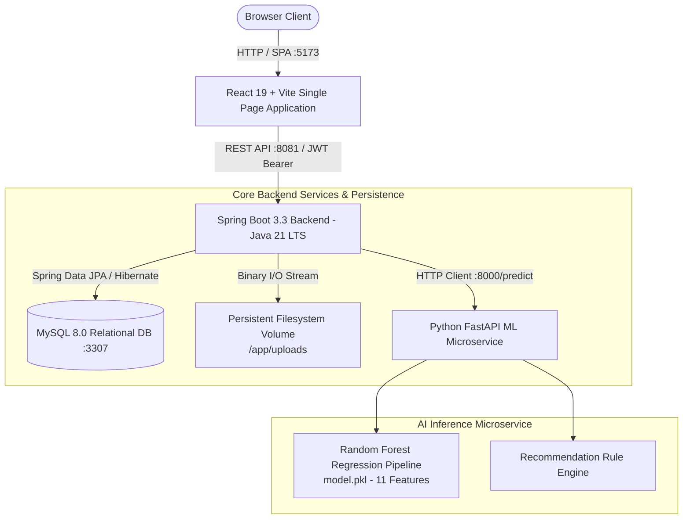

# AI-AcadPredict 🎓🤖
### AI-Integrated Academic Project Management & Delay Risk Prediction Platform

[](https://react.dev/)
[](https://spring.io/projects/spring-boot)
[](https://openjdk.org/)
[](https://fastapi.tiangolo.com/)
[](https://scikit-learn.org/)
[](https://www.mysql.com/)
[](https://www.docker.com/)
[](https://github.com/)

---

## 👥 Academic Context & Project Team

- **Institution:** KL University (KLH)
- **Department:** Computer Science & Engineering (CSE)
- **Course:** Advanced Software Engineering (ASE Project)
- **Academic Year:** 2026–2027

### Project Team Members

| Name | Student ID | Academic Role / Responsibilities |
|---|---|---|
| **R.L.S. Giridhar** | `2420030171` | Full-Stack Integration, Database Management, Dockerization & Verification Lead |
| **B. Srihitha** | `2420030099` | Frontend Development, UI/UX Architecture & Student Portal Design |
| **V. Sai Dhanush** | `2420030162` | Backend API Development, Spring Security, JWT & Relational Schema |
| **V. Mani MahaLakshmi** | `2420030773` | Machine Learning Microservice, Random Forest Modeling & Dataset Pipeline |

### Project Supervisor
**Dr. Lavanya Gottumukkala** — Assistant Professor , Department of Computer Science and Engineering

---

## 📄 Abstract

Academic project management in educational institutions frequently encounters severe operational bottlenecks, including manual progress tracking via static spreadsheets, delayed identification of at-risk student teams, fragmented communication channels, and minimal real-time visibility into project health. Traditional academic tracking systems focus strictly on retrospective administrative records and lack intelligent, data-driven mechanisms for proactive risk mitigation.

**AI-AcadPredict** is an enterprise-grade academic project management platform and delay risk prediction early-warning engine. Built using a modern distributed architecture—**React 19 + Vite** Single Page Application, **Spring Boot 3.3 (Java 21 LTS)** REST API, **MySQL 8.0** relational database, and an isolated **Python FastAPI** machine learning microservice—the system continuously aggregates 11 quantitative velocity and execution metrics (attendance, task completion rate, milestone timeliness, velocity lag, study hours). A trained **Random Forest regression model** predicts project delay probabilities, classifies risk levels into **LOW**, **MEDIUM**, or **HIGH**, forecasts calendar delay days, and triggers context-aware mitigation recommendations for supervisors and department coordinators before critical academic deadlines are breached.

---

## 📌 Table of Contents
1. [Project Objectives & Expected Outcomes](#-project-objectives--expected-outcomes)
2. [Project Lifecycle & Implementation Status](#-project-lifecycle--implementation-status)
3. [System Architecture](#-system-architecture)
4. [Key Modules & Capabilities](#-key-modules--capabilities)
5. [Role-Based Access Control (RBAC)](#-role-based-access-control-rbac)
6. [AI Delay Risk Prediction Engine](#-ai-delay-risk-prediction-engine)
7. [Technology Stack](#-technology-stack)
8. [Dataset Information](#-dataset-information)
9. [Repository Structure](#-repository-structure)
10. [Quick Start with Docker Compose](#-quick-start-with-docker-compose)
11. [Pre-Configured Test Credentials](#-pre-configured-test-credentials)
12. [REST API Reference Overview](#-rest-api-reference-overview)
13. [Testing & Quality Verification](#-testing--quality-verification)
14. [Comprehensive Documentation Index](#-comprehensive-documentation-index)

---

## 🎯 Project Objectives & Expected Outcomes

### Core Objectives
- **Centralized Project Lifecycle Management:** Unified repository for student proposals, team allocations, sprint tasks, milestones, academic reviews, and document deliverables.
- **Data-Driven Early Intervention:** Real-time delay risk prediction leveraging machine learning to eliminate end-of-semester project failure surprises.
- **Transparent Academic Governance:** Multi-tier role permissions enabling students to work autonomously, faculty guides to evaluate submissions with structured feedback, and coordinators to balance guide workloads across entire departments.
- **Zero Mock Data Architecture:** Dashboards, analytics cards, and risk meters are 100% computed from live relational database records.
- **Persistent Binary Asset Storage:** Decoupled document engine storing file metadata in MySQL while persisting binary contents directly to secure host/container storage volumes.

### Expected Outcomes
- ✅ 80% reduction in manual supervisor follow-up overhead through automated risk flagging.
- ✅ Early identification of at-risk academic projects 3 to 6 weeks before final submission dates.
- ✅ Elimination of unassigned student projects via centralized coordinator guide allocation.
- ✅ Continuous traceability of student contributions with granular task assignment and milestone evaluation.

---

## 📊 Project Lifecycle & Implementation Status

> [!NOTE]
> **Status:** **100% Fully Implemented, Integrated, Tested, and Dockerized.**

| Project Component / Lifecycle Phase | Initial Status | Final Delivered Status | Verification Outcome |
|---|---|---|---|
| **Requirements Analysis & Backlog** | Completed | **Completed** | Full user story catalog and acceptance criteria validated |
| **System Architecture Design** | In Progress | **Completed** | 4-tier microservice architecture fully orchestrated |
| **Relational Database Design (MySQL 8.0)** | In Progress | **Completed** | Normalized 8-table schema with foreign keys and cascade rules |
| **Frontend Development (React 19 + Vite)** | Not Started | **Completed** | Role-governed SPA with zero-mock data dashboards & full UI |
| **Backend Development (Spring Boot 3.3 Java 21)** | Not Started | **Completed** | 10 REST controllers, Spring Security, JWT filters, JPA services |
| **AI Model Development (Python FastAPI)** | Not Started | **Completed** | Random Forest model trained on 5,000 records; FastAPI inference API |
| **API Integration & JWT Security** | Not Started | **Completed** | Centralized Axios interceptor, Bearer tokens, RBAC route guards |
| **Document Management & Storage** | Not Started | **Completed** | Multipart uploads, SHA-256 storage keys, persistent volumes |
| **Testing & Quality Assurance** | Not Started | **Completed** | **58/58** Spring tests passed, ESLint clean, 12 FastAPI tests passed |
| **Multi-Container Deployment (Docker)** | Not Started | **Completed** | One-command `docker compose up -d` with persistent volumes |

---

## 🏗 System Architecture



### Architectural Highlights
- **Stateless Authentication:** Spring Security validates cryptographic HMAC-SHA256 JWT tokens on every inbound request.
- **Zero Mock Fallback:** Every statistic, chart, and count rendered on student, faculty, and coordinator dashboards represents genuine database state.
- **Fail-Safe Inference:** When the AI microservice is invoked, Spring Boot transmits runtime metrics to FastAPI and immediately logs the prediction result, risk level, confidence score, and recommendations into MySQL for historical tracking.

---

## 🚀 Key Modules & Capabilities

### 1. Differentiated Role Dashboards
- **Student Dashboard:** Active project overview, editable persistent progress bar, milestone deadlines, real-time AI risk meter, and proposal submission shortcuts.
- **Faculty Dashboard:** Supervision control center tracking 5 live metrics:
  - *Supervised Projects Count*
  - *Proposals Pending Academic Review*
  - *Projects with Upcoming Milestones*
  - *Projects with Overdue Milestones*
  - *Assigned Projects with HIGH Delay Risk*
  - Direct actions: "+ Add Student Account", "Supervisor Feedback & Milestone Review", "Assign Student to Task", and proposal review queues.
- **Coordinator Dashboard:** Departmental command room tracking 7 live metrics:
  - *Total Projects*, *Pending Review*, *Approved*, *Rejected*
  - *Projects with No Assigned Faculty Guide*
  - *Projects with Overdue Milestones*
  - *Projects with HIGH Delay Risk*
  - Direct controls: "+ Add User Account" (Student or Faculty), "Faculty Workload Allocation Overview" table, "Department Review History & Follow-Up Tracking" modal, and guide allocation.

### 2. Project Lifecycle & Proposal Review Workflow
- **Categorized Proposal Queues:** Filter by *All Proposals*, *Pending Review*, *Approved*, and *Rejected*.
- **Structured Academic Review:** Faculty supervisors and coordinators record formal review notes, status decisions (`APPROVED`, `REJECTED`, `PENDING_REVIEW`), reviewer identity, and review timestamps.
- **Persistent Progress Slider:** 0–100% project progress stored in MySQL, updateable by project owners and supervisors.
- **Safe Cascading Deletion:** Deletion requires typing the exact project name; securely cascades deletions across tasks, milestones, team associations, prediction logs, and persistent filesystem documents.

### 3. Sprint Tasks & Milestone Management
- **Task Delegation & Assignment:** Create work packages with priorities (`LOW`, `MEDIUM`, `HIGH`, `CRITICAL`), due dates, status updates, and assignment to registered team members with automatic assignee name resolution.
- **Milestone Evaluation:** Faculty guides assess milestone deliverables (`REVIEWED`, `NEEDS_ATTENTION`, `PENDING_REVIEW`) with persisted feedback notes.

### 4. Hybrid Document Management
- Support for project charters, SRS, design diagrams, and zip bundles up to 15MB.
- Binary payloads are streamed directly to `/app/uploads` persistent Docker volume.
- MySQL stores document metadata (uploader, project ID, content type, storage key, file size, timestamps).
- Secure downloads via JWT authentication with proper `Content-Disposition` attachment headers.

---

## 🔒 Role-Based Access Control (RBAC)

The system enforces strict role-based access control governed by Spring Security filters and domain services. Only **three** authorized roles exist:

| Role | Target User | Capabilities | Provisioning Method |
|---|---|---|---|
| **`STUDENT`** | Undergraduate / Postgraduate students | Create & manage self-owned projects, update progress, manage sprint tasks, assign team members, track milestones, upload documents, trigger AI predictions. Cannot review proposals or delete foreign projects. | **1. Public Registration:** Self-registration at `/register`.<br>**2. Staff Provisioning:** Added by Faculty or Coordinator. |
| **`FACULTY`** | Project Guides / Supervisors | View supervised and department projects, review proposals with academic feedback, evaluate project milestones, assign project tasks, provision Student accounts. | **1. Coordinator Provisioning:** Added via Coordinator dashboard.<br>**2. Seeder:** Pre-configured via development seed. |
| **`COORDINATOR`** | Department HOD / Project Coordinator | Department-wide oversight, allocate/reassign faculty guides, monitor faculty workload, record follow-up notes, provision Student and Faculty accounts, execute cascading project deletions. | **1. Seeder:** Pre-configured via development seed.<br>**2. Institutional DBA:** Direct database configuration. |

> [!NOTE]
> **Deliberate Absence of `ADMIN` Role:** There is deliberately no `ADMIN` role in AI-AcadPredict. Departmental oversight is fully handled by `COORDINATOR`. Any attempt to provision an `ADMIN` role returns `HTTP 400 Bad Request`.

---

## 🧠 AI Delay Risk Prediction Engine

The AI microservice is built with **FastAPI** and runs a trained **Random Forest** regression pipeline that evaluates 11 quantitative academic metrics:

```json
{
  "projectId": 12,
  "attendance": 85.0,
  "studyHours": 24.5,
  "previousPerformance": 78.0,
  "taskCompletion": 65.0,
  "pendingTasks": 4,
  "missedDeadlines": 1,
  "milestoneCompletion": 50.0,
  "daysRemaining": 45,
  "teamSize": 4,
  "projectType": 1,
  "projectProgress": 55
}
```

### Prediction Output & Risk Classification
- **Risk Level:**
  - 🟢 **`LOW`** (Delay probability < 35%)
  - 🟡 **`MEDIUM`** (Delay probability 35% – 65%)
  - 🔴 **`HIGH`** (Delay probability > 65%)
- **Predicted Delay Days:** Estimated calendar delay from nominal schedule.
- **Confidence Score:** Model certainty percentage based on feature consistency.
- **Actionable Recommendations:** Automated mitigation advice generated by the built-in recommendation engine (e.g. task reallocation, emergency supervisor check-in).

---

## 💻 Technology Stack

| Layer | Technology | Key Libraries / Frameworks | Purpose in AI-AcadPredict |
|---|---|---|---|
| **Frontend** | React 19, Vite | React Router DOM v7, CSS Variables / Design Tokens | Responsive Single Page Application, role-based navigation, dashboards |
| **Backend** | Spring Boot 3.3.4, Java 21 LTS | Spring Security, Spring Data JPA, JJWT 0.12.6, Hibernate | RESTful API, authentication filter, business logic, transactions |
| **AI Microservice** | Python 3.11, FastAPI | scikit-learn, NumPy, Pandas, Pydantic v2, Uvicorn | Random Forest inference, feature validation, recommendation engine |
| **Database** | MySQL 8.0 Community Server | InnoDB Engine, Foreign Key Constraints | Relational persistence, transactional data integrity |
| **Storage** | Hybrid Filesystem Engine | Java NIO, Docker Volumes | Secure document file persistence decoupled from MySQL |
| **Deployment** | Docker & Docker Compose v2 | Multi-stage Dockerfiles, Alpine Linux | Production containerization and service orchestration |
| **Testing** | JUnit 5, Mockito, PyTest | Spring Boot Test, H2 / MySQL TestContainers | Automated regression, API security, and integration testing |

---

## 📈 Dataset Information

The AI prediction service was trained using a structured dataset modeled after academic performance indicators:

- **Sample Size:** 5,000 synthetic academic project records.
- **Feature Matrix:** 11 features capturing team velocity, student attendance, historical performance, and backlog burndown.
- **Algorithms Evaluated:** Random Forest Regressor, Gradient Boosting, Linear Regression.
- **Selected Model:** **Random Forest Regressor** (n_estimators=100, max_depth=12), achieving high generalization and robust handling of non-linear delays.
- **Validation Metrics:** Evaluated with $R^2$ score, Mean Absolute Error (MAE), and Root Mean Squared Error (RMSE).

---

## 📁 Repository Structure

```
AcadPredict/
├── ai-service/                   # Python FastAPI Machine Learning Microservice
│   ├── data/raw/                 # Dataset generation script and synthetic training data
│   ├── models/                   # Trained Random Forest pipeline (model.pkl)
│   ├── src/                      # FastAPI app (main.py, preprocessing.py, schemas.py)
│   ├── tests/                    # 12 automated unit and integration tests
│   ├── Dockerfile                # Multi-stage Python 3.11 container definition
│   └── requirements.txt          # Python dependencies
├── frontend/                     # React 19 + Vite Single Page Application
│   ├── src/
│   │   ├── components/layout/    # Unified navigation layout (StudentLayout.jsx)
│   │   ├── pages/auth/           # Login.jsx, Register.jsx (with Show/Hide password toggles)
│   │   ├── pages/student/        # Role-based dashboards & project lifecycle modules
│   │   └── services/api.js       # Centralized JWT HTTP client with request interceptors
│   ├── Dockerfile                # Nginx-based production frontend build
│   └── package.json
├── spring-backend/               # Spring Boot 3.3 Java 21 REST API
│   ├── src/main/java/com/acadpredict/backend/
│   │   ├── config/               # SecurityConfig, CorsConfig, DevAccountInitializer
│   │   ├── controller/           # Project, Task, Milestone, Team, User, Prediction APIs
│   │   ├── dto/                  # Request and response data records
│   │   ├── entity/               # User, Project, Task, Milestone, TeamMember, Document
│   │   ├── repository/           # Spring Data JPA repositories
│   │   └── service/              # DocumentStorageService, AiPredictionService, AuthService
│   ├── Dockerfile                # Multi-stage JDK 21 build container definition
│   └── pom.xml                   # Maven dependencies
├── docker-compose.yml            # Multi-container orchestration specification
├── .env.example                  # Environment configuration template
├── README.md                     # Comprehensive technical documentation & quick start
├── ACADPREDICT_USER_GUIDE.md     # Complete operational manual
├── ACADPREDICT_ROLE_ACCESS_MATRIX.md # Detailed role and security permissions matrix
├── ACADPREDICT_API_REFERENCE.md  # Comprehensive REST API specifications
├── ACADPREDICT_DEMO_CHECKLIST.md # Live demonstration script & presentation checklist
└── MEMBER4_AUDIT_REPORT.md       # Comprehensive system audit and verification report
```

---

## ⚡ Quick Start with Docker Compose

### Prerequisites
- [Docker Desktop](https://www.docker.com/products/docker-desktop/) (Version 24.0+ recommended) with Docker Compose v2.
- A modern web browser.

### 1. Build & Start All Services
Run the following command from the project root:

```powershell
# 1. Build and launch all 4 services in detached mode
docker compose up -d --build

# 2. Verify all containers are healthy
docker compose ps
```

### 2. Service Access Points

| Service | Host URL | Description |
|---|---|---|
| **Web Application** | `http://localhost:5173` | React Single Page Application |
| **Backend REST API** | `http://localhost:8081` | Spring Boot REST API |
| **Backend Health Check** | `http://localhost:8081/api/health` | Service and MySQL database status |
| **AI Microservice Health** | `http://localhost:8000/health` | Model status (`{"status":"healthy"}`) |
| **AI OpenAPI Documentation** | `http://localhost:8000/docs` | Interactive Swagger UI |
| **MySQL Relational Database** | `localhost:3307` | MySQL port mapped from 3306 |

### 3. Safe Shutdown & Restart
```powershell
# Safely stop services without losing database or uploaded files
docker compose down

# Restart running containers
docker compose restart
```

> [!WARNING]
> Do **NOT** run `docker compose down -v` unless you explicitly want to delete your persistent database data and stored project files!

---

## 🔑 Pre-Configured Test Credentials

When starting with development provisioning enabled (`DEV_PROVISION_ACCOUNTS=true`), the following test accounts are initialized:

| Role | Email Address | Password | Display Name | Scope |
|---|---|---|---|---|
| **`COORDINATOR`** | `coordinator@college.edu` | `CoordinatorPass123!` | Prof. Williams | Department-wide oversight, guide allocation, follow-ups |
| **`FACULTY`** | `faculty@college.edu` | `FacultyPass123!` | Dr. Sharma | Supervision view, proposal review, milestone evaluation |
| **`STUDENT`** | Register fresh at `/register` | User chosen | User chosen | Personal project ownership, tasks, documents |

---

## 📡 REST API Reference Overview

All protected endpoints require an `Authorization: Bearer <jwt_token>` header.

### Authentication & Users
- `POST /api/auth/register` — Public student registration.
- `POST /api/auth/login` — Authenticate and receive JWT.
- `POST /api/users` — Staff account creation (Faculty: Student only; Coordinator: Student or Faculty).
- `GET /api/users/faculty` — List active faculty members.
- `GET /api/users/students` — List active student members.

### Projects & Supervision
- `GET /api/projects` — Get projects (Students: owned projects; Staff: all department projects).
- `POST /api/projects` — Submit project proposal.
- `PUT /api/projects/{id}/progress` — Update project progress (0–100%).
- `PUT /api/projects/{id}/assign-guide` — Coordinator allocates or reassigns faculty guide.
- `PUT /api/projects/{id}/review` — Faculty/Coordinator reviews proposal with academic feedback.
- `PUT /api/projects/{id}/follow-up` — Coordinator records departmental tracking note.
- `DELETE /api/projects/{id}` — Safe cascading deletion of project, filesystem documents, and records.

### Tasks & Milestones
- `POST /api/tasks` — Create task with assignee selection (`assignedToId`).
- `PUT /api/tasks/{id}` — Update task status, priority, due date, or assignee.
- `DELETE /api/tasks/{id}` — Delete task.
- `POST /api/projects/{id}/milestones` — Create project milestone.
- `PUT /api/milestones/{id}/review` — Supervisor evaluates milestone (`REVIEWED`, `NEEDS_ATTENTION`).

### Documents & AI Inference
- `POST /api/documents/upload` — Multipart file upload to persistent filesystem storage.
- `GET /api/documents/{id}/download` — Authenticated stream download with content disposition.
- `POST /api/predictions/predict` — Trigger Random Forest ML inference and log prediction to MySQL.

*For complete schemas, request/response payloads, and error codes, see [ACADPREDICT_API_REFERENCE.md](ACADPREDICT_API_REFERENCE.md).*

---

## 🧪 Testing & Quality Verification

AI-AcadPredict has been thoroughly verified through automated tests across all tiers:

| Test Suite | Scope | Command | Outcome |
|---|---|---|---|
| **Spring Boot Unit & Integration** | 58 JUnit 5 tests covering security, controllers, RBAC, and cascading deletion | `cd spring-backend && mvn test` | **58 passed, 0 failed, 0 errors** |
| **Frontend Code Quality** | ESLint static analysis across React components | `cd frontend && npm run lint` | **0 errors, 0 warnings** |
| **Frontend Production Build** | Vite production bundling | `cd frontend && npm run build` | **Clean build (< 400ms)** |
| **FastAPI ML Tests** | 12 pytest unit and integration tests | `cd ai-service && pytest` | **12 passed, 0 failed** |
| **Live End-to-End Test Suite** | 8-phase PowerShell live container verification script | `powershell -File scratch/verify_all_new_features.ps1` | **100% Pass Rate** |

---

## 📚 Comprehensive Documentation Index

Explore the dedicated documentation files for in-depth technical details:

1. 📖 **[ACADPREDICT_USER_GUIDE.md](ACADPREDICT_USER_GUIDE.md)**: Complete operational manual for students, supervisors, coordinators, and examiners.
2. 🛡️ **[ACADPREDICT_ROLE_ACCESS_MATRIX.md](ACADPREDICT_ROLE_ACCESS_MATRIX.md)**: Exhaustive security matrix, route authorization, and privilege boundaries.
3. 📑 **[ACADPREDICT_API_REFERENCE.md](ACADPREDICT_API_REFERENCE.md)**: Full REST API specification with example payloads and status codes.
4. 📋 **[ACADPREDICT_DEMO_CHECKLIST.md](ACADPREDICT_DEMO_CHECKLIST.md)**: Step-by-step presentation script, examiner demonstration sequence, and SQL proof queries.
5. 📊 **[MEMBER4_AUDIT_REPORT.md](MEMBER4_AUDIT_REPORT.md)**: Member 4 comprehensive audit report detailing all implementation phases, architecture decisions, and test outcomes.

---

## ⚖️ License & Academic Compliance

- **Platform:** AI-AcadPredict (Advanced Software Engineering Project)
- **Institution:** KL University (KLH)
- **Academic Year:** 2026–2027
- **License:** For Academic Project Evaluation and Educational Use Only
- **Copyright:** © 2026 AI-AcadPredict Team (R.L.S. Giridhar, B. Srihitha, V. Sai Dhanush, V. Mani MahaLakshmi)
